### Changelog da revisão 3.1

- **Casos de uso reorganizados:** os casos passaram a ser folhas específicas e incluiram apenas relações UML explicitadas por rótulos `«include»` e `«extend»`.
- **Modelo corrigido:** orçamento foi removido como classe independente e representado pelo mapa `budgets` associado à categoria.
- **Fluxos UML completos:** atividades ganharam raias, estados ganharam guardas e ações, e sequências ganharam participantes e exclusões em português.
- **Modelo alinhado ao código:** nomes de domínio, enumeração de pagamentos, fallback de categorias e unicidade dos gastos fixos refletem `index.html`.
- **Notação UML corrigida:** relações `<<include>>` e `<<extend>>` foram substituídas por rótulos `«include»` e `«extend»` entre aspas; casos internos de persistência e recálculo deixaram de ser casos de uso.
- **Qualidade documental ampliada:** regras de negócio, dicionário, mensagens, implantação, rastreabilidade e histórico foram adicionados.

# Documentação UML 3.1 — Para Onde Foi Meu Dinheiro

**Versão do documento:** 3.1  
**Versão analisada do sistema:** implementação em `index.html`  
**Metodologia:** UML 2.5 aplicada ao comportamento real  
**Tipo de sistema:** aplicação web responsiva para controle pessoal de despesas  
**Tecnologia:** HTML5, CSS3 e JavaScript ES6  
**Persistência:** `localStorage` do navegador  
**Ator principal:** Usuário  
**Chave de persistência:** `para-onde-foi-meu-dinheiro-v1`

## 1. Objetivo e escopo

O sistema permite cadastrar, editar, excluir e filtrar gastos mensais; criar, editar e excluir categorias; definir limites por categoria; cadastrar gastos fixos e lançá-los no mês; consultar resumo, comparação, média, gráficos e ranking; exportar dados; importar backups; carregar exemplos; e apagar todos os dados.

Não há servidor, autenticação, banco de dados remoto ou compartilhamento entre navegadores. Os dados pertencem ao perfil de navegação em que foram criados.

Os valores monetários são armazenados em centavos. Datas usam `AAAA-MM-DD`, meses usam `AAAA-MM` e as formas de pagamento são: **Dinheiro, Débito, Crédito e Pix**.

## 2. Diagrama de casos de uso

A legenda abaixo indica a notação utilizada: ator fora da fronteira do sistema, casos de uso representados por elipses e relações UML representadas por setas tracejadas. Mermaid não possui notação nativa para casos de uso; por isso, o diagrama usa `flowchart` como representação visual. Relações: `«include»` e `«extend»` aparecem entre aspas em seus rótulos.

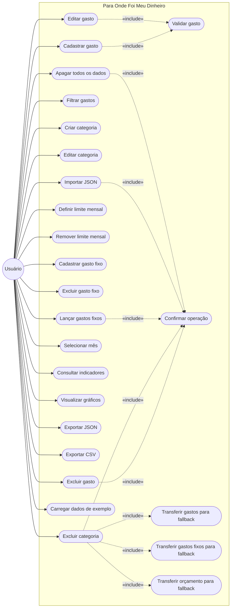

### 2.1 Descrições detalhadas dos casos de uso

#### UC01 — Cadastrar gasto

- **Ator:** Usuário.
- **Pré-condição:** existe pelo menos uma categoria.
- **Pós-condição:** o gasto é armazenado em centavos e o painel é recalculado.
- **Fluxo principal:**
  1. O usuário informa valor, categoria, descrição, data e forma de pagamento.
  2. O sistema valida os dados durante o envio do formulário.
  3. O sistema converte o valor informado em centavos.
  4. O sistema gera um identificador único e adiciona o gasto ao estado.
  5. O sistema persiste o estado no armazenamento local.
  6. O sistema atualiza o painel e informa o sucesso.
- **Fluxos alternativos e de exceção:**
  1. A1: o valor é menor ou igual a zero; o sistema informa o erro e mantém o formulário.
  2. A2: a data é inválida; o sistema informa o erro e mantém o formulário.
  3. A3: não existe categoria selecionada; o sistema informa o erro.
  4. E1: o armazenamento local lança erro; o sistema informa a falha e não confirma o registro.

#### UC02 — Editar gasto

- **Ator:** Usuário.
- **Pré-condição:** existe um gasto na lista.
- **Pós-condição:** o gasto existente é substituído e o painel é recalculado.
- **Fluxo principal:**
  1. O usuário seleciona Editar no gasto.
  2. O sistema localiza o gasto pelo identificador e preenche o formulário.
  3. O usuário altera os campos e envia o formulário.
  4. O sistema valida os dados e substitui o gasto no estado.
  5. O sistema persiste e recalcula o painel.
- **Fluxos alternativos e de exceção:**
  1. A1: o usuário cancela; o sistema volta ao modo de cadastro.
  2. E1: os dados são inválidos; o sistema mantém o modo de edição e informa o erro.

#### UC03 — Excluir gasto

- **Ator:** Usuário.
- **Pré-condição:** existe um gasto na lista.
- **Pós-condição:** o gasto é removido do estado e o painel é recalculado.
- **Fluxo principal:**
  1. O usuário seleciona Excluir.
  2. O sistema solicita confirmação.
  3. O usuário confirma.
  4. O sistema remove o gasto pelo identificador e persiste o estado.
  5. O sistema recalcula o painel.
- **Fluxos alternativos e de exceção:**
  1. A1: o usuário cancela; o sistema não altera o estado.
  2. E1: o armazenamento local falha; o sistema informa a falha.

#### UC04 — Filtrar gastos

- **Ator:** Usuário.
- **Pré-condição:** existe mês selecionado.
- **Pós-condição:** a lista contém somente os gastos compatíveis com todos os filtros ativos.
- **Fluxo principal:**
  1. O usuário informa mês, categoria, forma de pagamento ou texto da descrição.
  2. O sistema aplica os filtros ao estado.
  3. O sistema ordena por data decrescente e por ordem de criação quando necessário.
  4. O sistema atualiza a quantidade e a lista.
- **Fluxo alternativo:** A1: nenhum gasto corresponde; o sistema mostra uma lista vazia.

#### UC05 — Criar categoria

- **Ator:** Usuário.
- **Pré-condição:** nenhuma.
- **Pós-condição:** a nova categoria existe no estado e nos seletores.
- **Fluxo principal:**
  1. O usuário informa nome e cor.
  2. O sistema impede nome vazio e nome duplicado sem distinção de maiúsculas e minúsculas.
  3. O sistema gera identificador e adiciona a categoria.
  4. O sistema persiste e atualiza os seletores.
- **Fluxos alternativos e de exceção:**
  1. A1: nome vazio; o sistema não cria.
  2. A2: nome duplicado; o sistema informa que já existe.

#### UC06 — Editar categoria

- **Ator:** Usuário.
- **Pré-condição:** existe pelo menos uma categoria.
- **Pós-condição:** nome e cor da categoria são atualizados.
- **Fluxo principal:**
  1. O usuário altera nome ou cor na linha da categoria.
  2. O usuário seleciona Salvar.
  3. O sistema impede nome vazio e duplicado.
  4. O sistema persiste e atualiza os componentes.

#### UC07 — Excluir categoria

- **Ator:** Usuário.
- **Pré-condição:** existem pelo menos duas categorias.
- **Pós-condição:** os dados associados à categoria são transferidos e a categoria é removida.
- **Fluxo principal:**
  1. O usuário solicita a exclusão.
  2. O sistema solicita confirmação.
  3. O usuário confirma.
  4. O sistema seleciona uma categoria fallback, preferencialmente “Outros”.
  5. O sistema transfere todos os gastos e gastos fixos.
  6. O sistema transfere o orçamento ou aplica a regra de orçamento do fallback.
  7. O sistema remove a categoria e persiste o estado.
- **Fluxos alternativos e de exceção:**
  1. A1: o usuário cancela; nenhuma alteração ocorre.
  2. E1: existe somente uma categoria; o sistema impede a exclusão.

#### UC08 — Definir limite mensal

- **Ator:** Usuário.
- **Pré-condição:** existe categoria selecionada.
- **Pós-condição:** o limite é associado à categoria em centavos.
- **Fluxo principal:**
  1. O usuário seleciona categoria e informa limite.
  2. O sistema rejeita valor menor ou igual a zero.
  3. O sistema converte o valor em centavos e persiste no mapa de limites.
  4. O sistema recalcula as barras de orçamento.

#### UC09 — Remover limite mensal

- **Ator:** Usuário.
- **Pré-condição:** existe limite mensal configurado.
- **Pós-condição:** o limite da categoria é removido.
- **Fluxo principal:**
  1. O usuário seleciona remover no limite.
  2. O sistema exclui a entrada do mapa e persiste o estado.

#### UC10 — Cadastrar gasto fixo

- **Ator:** Usuário.
- **Pré-condição:** existe categoria selecionada.
- **Pós-condição:** o modelo de gasto fixo é persistido.
- **Fluxo principal:**
  1. O usuário informa nome, valor, categoria, dia de vencimento e pagamento.
  2. O sistema valida valor positivo e dia entre 1 e 31.
  3. O sistema gera identificador e adiciona o modelo ao estado.
  4. O sistema persiste o estado.

#### UC11 — Excluir gasto fixo

- **Ator:** Usuário.
- **Pré-condição:** existe gasto fixo cadastrado.
- **Pós-condição:** o modelo é removido.
- **Fluxo principal:**
  1. O usuário solicita excluir.
  2. O sistema solicita confirmação.
  3. O usuário confirma.
  4. O sistema remove o modelo e persiste o estado.
- **Fluxo alternativo:** A1: o usuário cancela; nenhuma alteração ocorre.

#### UC12 — Lançar gastos fixos

- **Ator:** Usuário.
- **Pré-condição:** existe pelo menos um modelo de gasto fixo.
- **Pós-condição:** todos os modelos pendentes são lançados uma única vez no mês.
- **Fluxo principal:**
  1. O usuário solicita lançar todos no mês selecionado.
  2. O sistema identifica os pares `fixedId` e `fixedMonth` já existentes.
  3. O sistema filtra os modelos pendentes.
  4. O sistema solicita confirmação.
  5. O usuário confirma.
  6. O sistema ajusta o dia ao último dia válido do mês.
  7. O sistema cria os gastos vinculados e persiste o estado.
- **Fluxos alternativos e de exceção:**
  1. A1: não existem modelos; o sistema orienta o usuário.
  2. A2: todos os modelos já foram lançados; o sistema informa a duplicidade evitada.
  3. A3: o usuário cancela; nenhuma alteração ocorre.

#### UC13 — Selecionar mês

- **Ator:** Usuário.
- **Pré-condição:** nenhuma.
- **Pós-condição:** o mês atualiza painel, filtros e lançamentos.
- **Fluxo principal:**
  1. O usuário usa o seletor ou os botões anterior e próximo.
  2. O sistema sincroniza mês do painel e filtro da lista.
  3. O sistema recalcula todos os componentes mensais.

#### UC14 — Consultar indicadores

- **Ator:** Usuário.
- **Pré-condição:** existe mês selecionado.
- **Pós-condição:** os indicadores são exibidos.
- **Fluxo principal:**
  1. O sistema soma os gastos do mês.
  2. O sistema obtém o total do mês anterior.
  3. O sistema calcula média por dia e variação percentual.
  4. O sistema identifica a maior categoria.

#### UC15 — Visualizar gráficos

- **Ator:** Usuário.
- **Pré-condição:** existe mês selecionado.
- **Pós-condição:** gráficos são exibidos.
- **Fluxo principal:**
  1. O sistema agrega os gastos por categoria e por dia.
  2. O sistema gera gráfico de rosca, barras diárias e ranking.
- **Fluxo alternativo:** A1: não existem gastos; o sistema mostra estados vazios.

#### UC16 — Exportar JSON

- **Ator:** Usuário.
- **Pré-condição:** nenhuma.
- **Pós-condição:** o navegador baixa um arquivo JSON completo.
- **Fluxo principal:**
  1. O usuário solicita exportar.
  2. O sistema serializa estado e metadados em JSON.

#### UC17 — Exportar CSV

- **Ator:** Usuário.
- **Pré-condição:** existe mês selecionado.
- **Pós-condição:** o navegador baixa o CSV do mês selecionado.
- **Fluxo principal:**
  1. O usuário solicita exportar CSV.
  2. O sistema monta linhas com data, categoria, descrição, pagamento e valor.

#### UC18 — Importar JSON

- **Ator:** Usuário.
- **Pré-condição:** o usuário seleciona um arquivo.
- **Pós-condição:** o estado válido substitui o estado atual após confirmação.
- **Fluxo principal:**
  1. O usuário seleciona um arquivo JSON.
  2. O sistema lê e decodifica o arquivo.
  3. O sistema valida a estrutura e as entidades.
  4. O sistema solicita confirmação.
  5. O usuário confirma.
  6. O sistema substitui o estado, persiste e recalcula.
- **Fluxos alternativos e de exceção:**
  1. A1: o usuário cancela; o estado não muda.
  2. E1: o arquivo é inválido; o sistema mostra o erro.

#### UC19 — Carregar dados de exemplo

- **Ator:** Usuário.
- **Pré-condição:** nenhuma.
- **Pós-condição:** trinta gastos fictícios são adicionados ao mês selecionado.
- **Fluxo principal:**
  1. O usuário solicita carregar exemplos.
  2. Se já existem gastos, o sistema solicita confirmação para adicionar.
  3. O usuário confirma.
  4. O sistema gera os dados no mês selecionado e persiste.

#### UC20 — Apagar todos os dados

- **Ator:** Usuário.
- **Pré-condição:** nenhuma.
- **Pós-condição:** estado vazio padrão é persistido.
- **Fluxo principal:**
  1. O usuário solicita apagar todos os dados.
  2. O sistema solicita confirmação.
  3. O usuário confirma.
  4. O sistema restaura categorias padrão, gastos vazios, limites vazios e gastos fixos vazios.
  5. O sistema persiste e recalcula.

## 3. Diagrama de classes de domínio

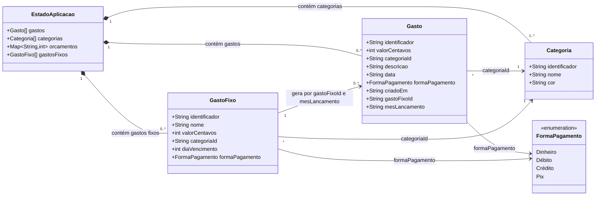

O orçamento é um mapa composto por `EstadoAplicacao`, chamado no modelo de `orcamentos` e no código de `budgets`. A chave é `categoriaId` e o valor é o limite em centavos.

## 4. Diagrama de componentes e arquitetura

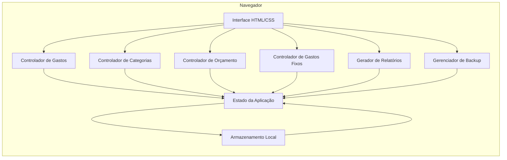

Os controladores correspondem às funções e listeners JavaScript: no código atual não existem classes separadas. Esta arquitetura representa a responsabilidade lógica da implementação.

## 5. Diagramas de atividade

Nas atividades abaixo, os subgraphs representam raias simuladas em Mermaid: Usuário, Interface, Lógica e `localStorage`. Mermaid não oferece raias UML nativas.

### 5.1 Cadastrar ou editar gasto

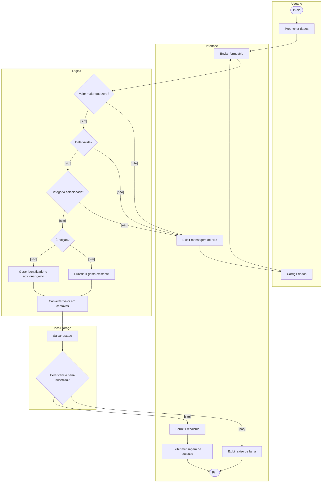

### 5.2 Selecionar mês e consultar painel

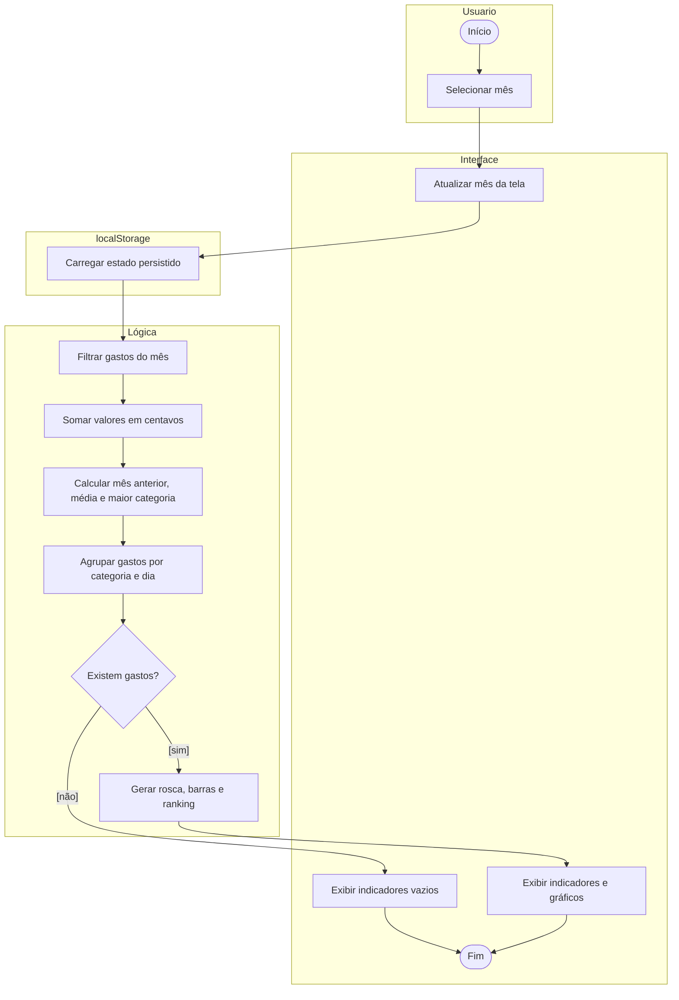

### 5.3 Lançar gastos fixos

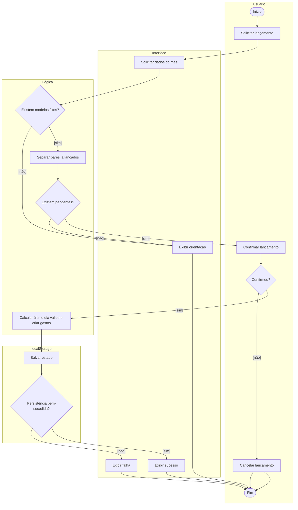

### 5.4 Excluir categoria

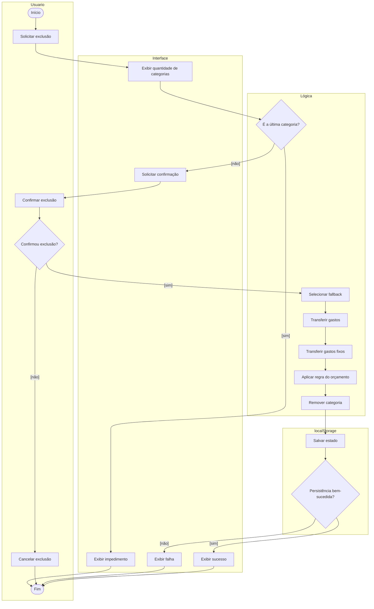

### 5.5 Importar backup

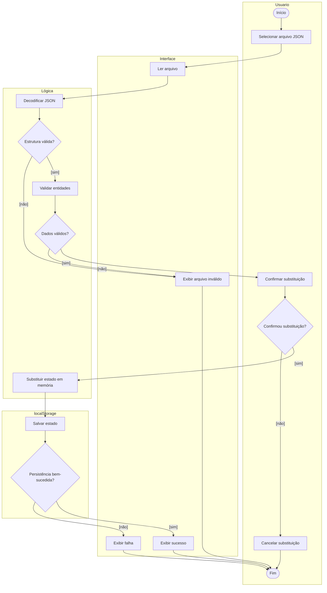
## 6. Estados do formulário de gasto

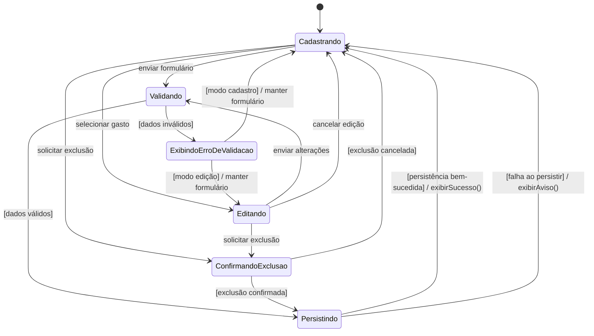

## 7. Diagramas de sequência

### 7.1 Cadastrar gasto

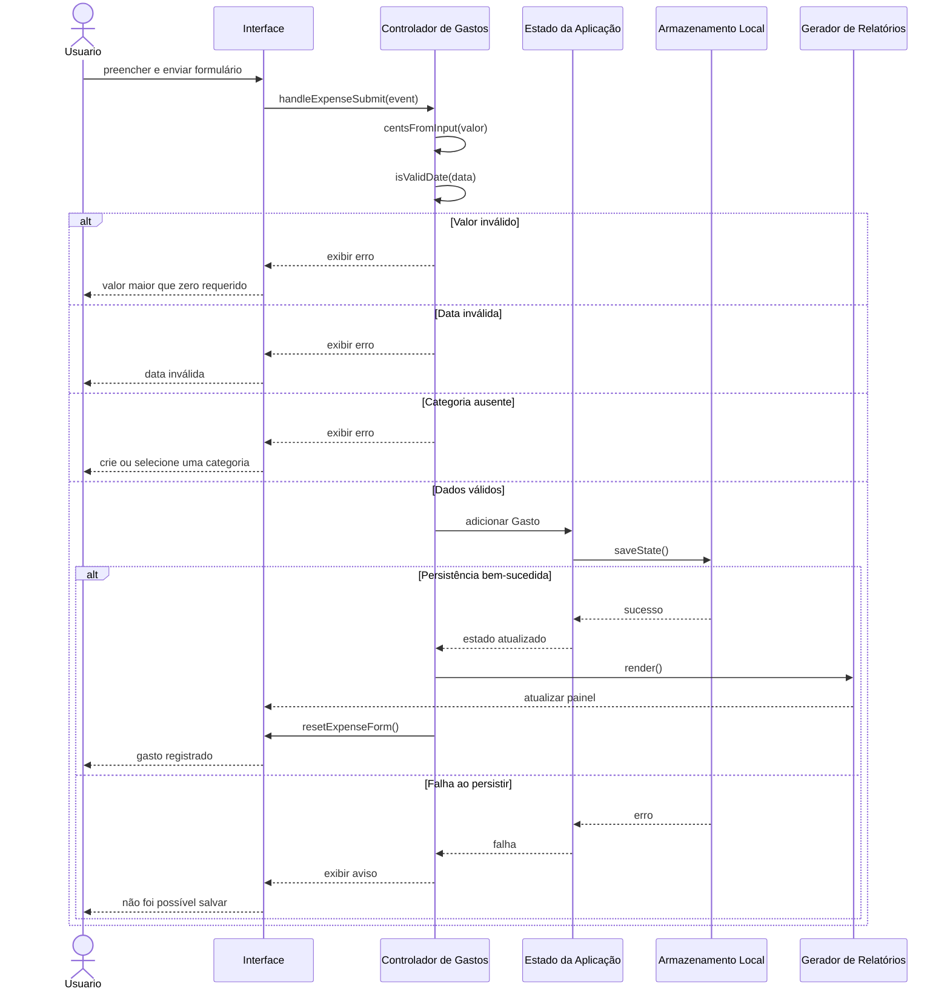

### 7.2 Editar e excluir gasto

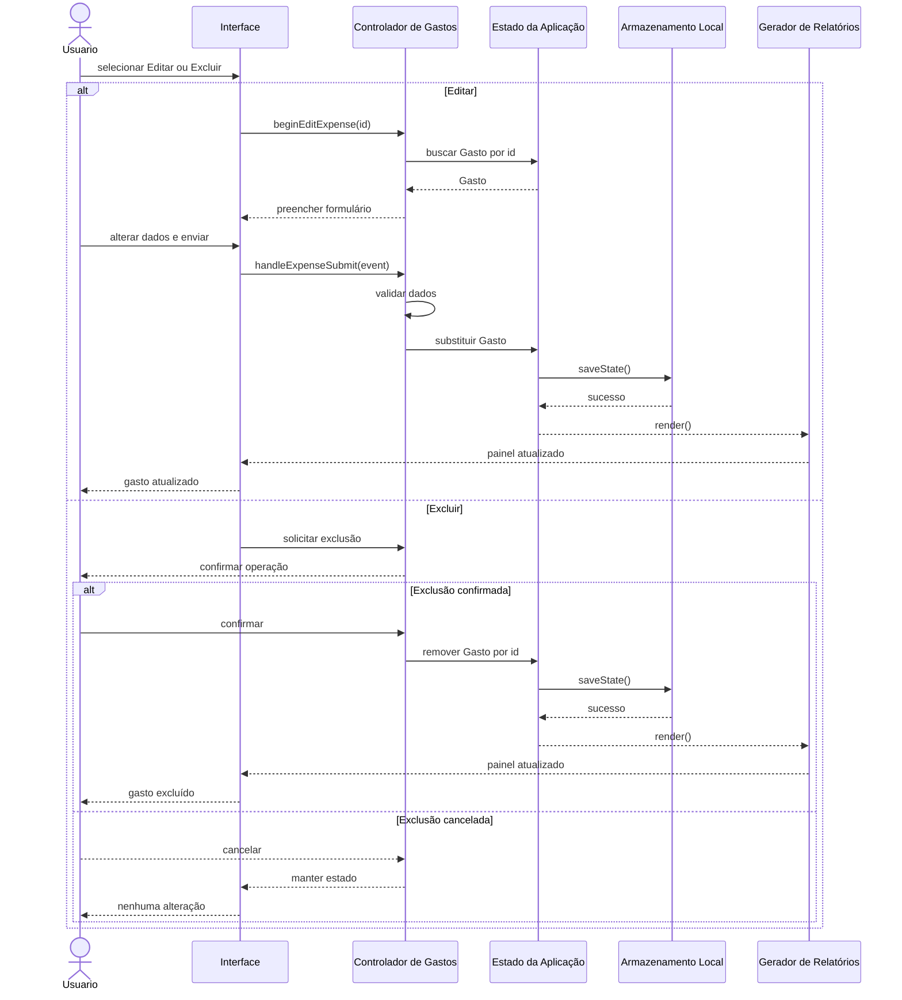

### 7.3 Definir limite mensal

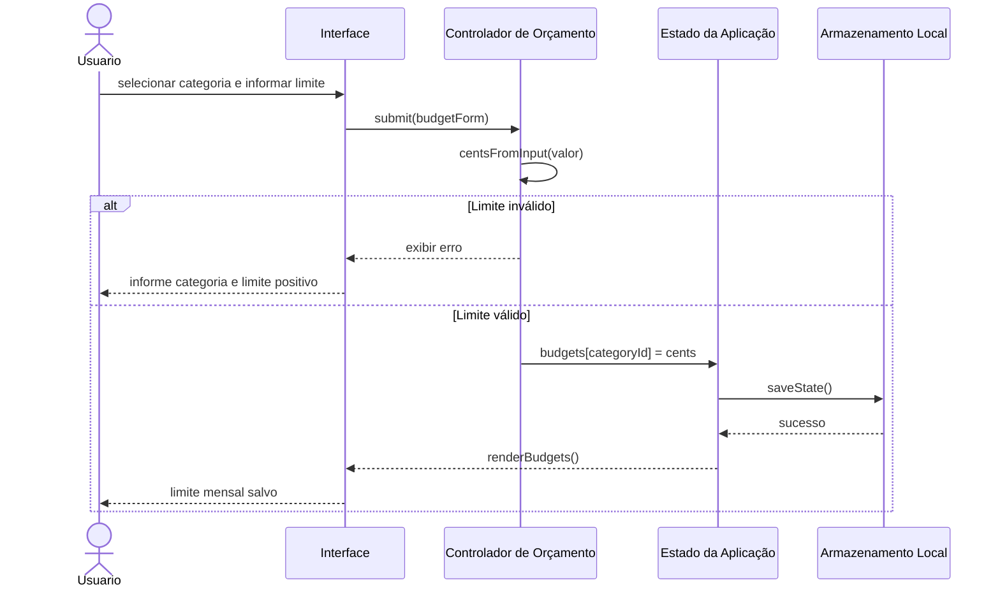

### 7.4 Lançar gastos fixos

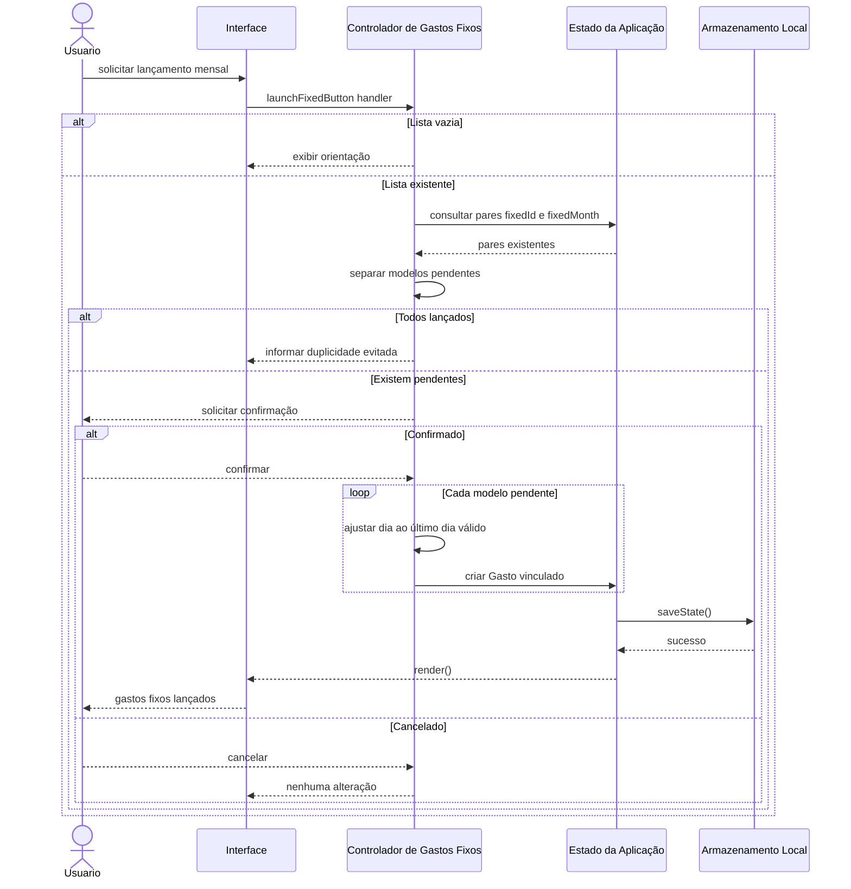

### 7.5 Importar backup

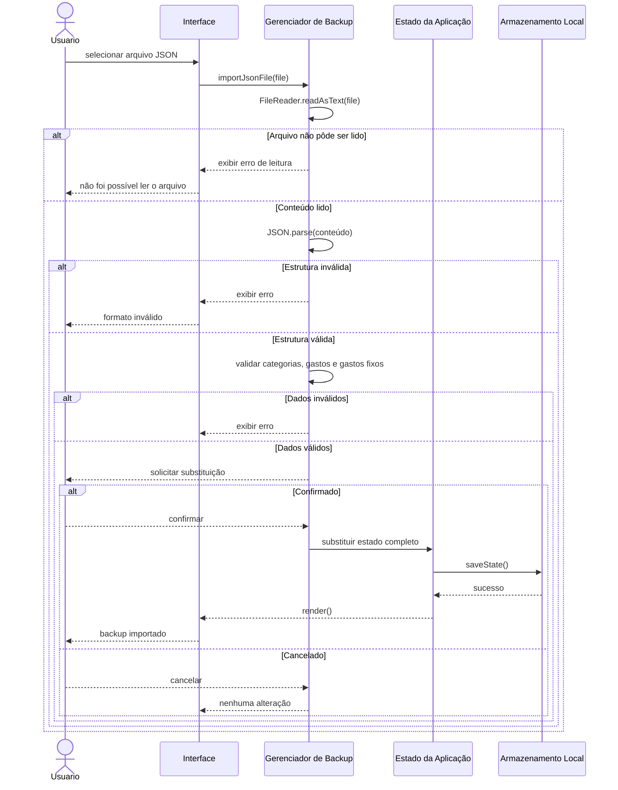

### 7.6 Excluir categoria

```mermaid
sequenceDiagram
    actor Usuario
    participant UI as Interface
    participant CC as Controlador de Categorias
    participant E as Estado da Aplicação
    participant AL as Armazenamento Local

    Usuario->>UI: solicitar excluir categoria
    UI->>CC: remover categoria(id)

    alt É a última categoria
        CC-->>UI: impedir exclusão
        UI-->>Usuario: mantenha pelo menos uma categoria
    else Existem outras categorias
        CC->>CC: selecionar fallback Outros ou primeira disponível
        CC-->>Usuario: confirmar operação
        alt Exclusão cancelada
            Usuario-->>CC: cancelar
            CC-->>UI: nenhuma alteração
        else Exclusão confirmada
            Usuario-->>CC: confirmar
            CC->>E: transferir gastos categoryId para fallback
            CC->>E: transferir gastos fixos categoryId para fallback
            CC->>E: aplicar regra ao orçamento
            CC->>E: remover Categoria
            E->>AL: saveState()
            AL-->>E: sucesso
            E-->>UI: render()
            UI-->>Usuario: categoria excluída; dados preservados
        end
    end
```

## 8. Diagrama de implantação

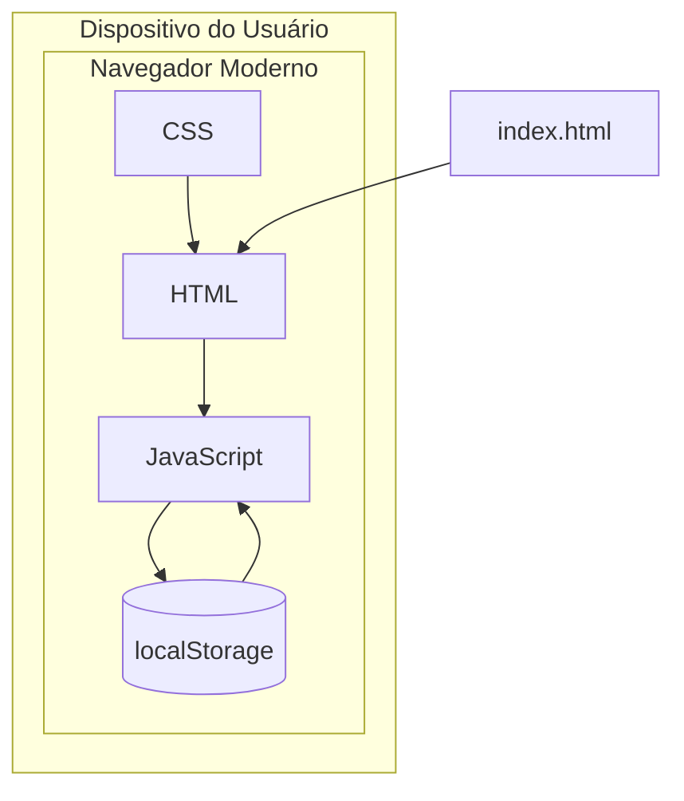

Não existe servidor de aplicação. Os arquivos HTML, CSS e JavaScript são carregados localmente ou servidos por servidor de arquivos. Os dados persistem no navegador.

## 9. Regras de Negócio

| ID | Descrição determinística | Requisitos relacionados | Elemento UML relacionado | Aplicação no código |
|---|---|---|---|---|
| RN01 | Para inclusão, o gasto é aceito somente quando o valor convertido é maior que zero. Para edição, o mesmo gasto continua sujeito à mesma validação positiva. | RF01, RF02 | UC01, UC02, Gasto | `handleExpenseSubmit()` e `centsFromInput()` |
| RN02 | Para inclusão, o gasto é aceito somente quando `date` segue `AAAA-MM-DD` e representa uma data real. Para edição, a mesma data é validada antes da substituição. | RF01, RF02 | UC01, UC02, Gasto | `isValidDate()` em `handleExpenseSubmit()` |
| RN03 | Todo valor monetário é convertido para inteiro em centavos antes de entrar no estado. | RF01, RF02, RF06, RF07 | Gasto, GastoFixo, EstadoAplicacao | `centsFromInput()` |
| RN04 | Cada categoria possui identificador, nome e cor válidos. Nomes não podem ser vazios nem duplicados sem distinção de maiúsculas e minúsculas. | RF05 | UC05, UC06, Categoria | `categoryForm`, `categoryList` |
| RN05 | O orçamento consome gastos da categoria no mês selecionado. A barra é verde quando o consumo é menor que 70%; é amarelo entre 70% inclusive e 100% inclusive; é vermelho quando o consumo ultrapassa 100%. | RF06, RF09 | UC08, EstadoAplicacao | `renderBudgets()` |
| RN06 | Ao lançar gasto fixo, o dia informado é limitado ao último dia válido do mês selecionado. | RF07, RF08 | UC12, GastoFixo | `launchFixedButton` handler |
| RN07 | Um modelo fixo é único no mês somente pela combinação `fixedId + fixedMonth`. O sistema não cria segundo lançamento para essa combinação. | RF07, RF08 | UC12, GastoFixo, Gasto | `launchFixedButton` handler |
| RN08 | Ao excluir uma categoria: todos os gastos com `categoryId` igual ao identificador excluído são transferidos para o fallback; todos os gastos fixos com o mesmo `categoryId` são transferidos para o fallback. | RF05 | UC07, Gasto, GastoFixo | `categoryList` listener |
| RN09 | O fallback ao excluir categoria é a categoria chamada “Outros” com outro identificador; se ela não existir, o fallback é a primeira categoria disponível com outro identificador. | RF05 | UC07, Categoria | `categoryList` listener |
| RN10 | Ao excluir uma categoria, se o fallback não possuir orçamento, o orçamento da categoria excluída é transferido para o fallback. Se o fallback já possuir orçamento, o orçamento da categoria excluída é removido. | RF05, RF06 | UC07, EstadoAplicacao | `categoryList` listener |
| RN11 | A última categoria existente não pode ser excluída. | RF05 | UC07, Categoria | `categoryList` listener |
| RN12 | Ações destrutivas exigem confirmação antes da alteração: excluir gasto, excluir gasto fixo, excluir categoria, importar backup substitutivo, carregar exemplos sobre dados existentes e apagar todos os dados. | RF03, RF05, RF07, RF12, RF14 | UC03, UC07, UC11, UC18, UC19, UC20 | listeners e handlers dos respectivos eventos |
| RN13 | Gasto fixo requer valor inteiro positivo, dia inteiro entre 1 e 31, categoria existente e forma de pagamento reconhecida. | RF07 | UC10, GastoFixo | `isValidFixed()` e `fixedForm` submit |
| RN14 | O importador aceita gastos somente quando a categoria referenciada existe no conteúdo importado e todos os campos passam na validação. | RF12 | UC18, EstadoAplicacao | `importJsonFile()` |
| RN15 | Os dados só são considerados válidos após consistência de identificadores, formatos, valores positivos e formas de pagamento permitidas. | RF12, RF13 | UC18, EstadoAplicacao | `loadState()` e `importJsonFile()` |

## 10. Dicionário de dados

### Estado da Aplicação

| Campo | Tipo | Obrigatório | Restrições | Exemplo |
|---|---|---|---|---|
| `gastos` (`expenses`) | Lista de Gasto | Sim | Lista válida; objetos inválidos são filtrados ao carregar | `[{"id":"id-1","cents":3290}]` |
| `categorias` (`categories`) | Lista de Categoria | Sim | Deve haver pelo menos uma categoria no estado válido | `[{"id":"cat-1","name":"Alimentação","color":"#e27b54"}]` |
| `orcamentos` (`budgets`) | Map<categoriaId, int> | Sim | Chaves correspondem a categorias; valores em centavos positivos | `{"cat-1":50000}` |
| `gastosFixos` (`fixed`) | Lista de GastoFixo | Sim | Lista de modelos válidos | `[{"id":"fix-1","day":10}]` |

### Gasto

| Campo | Tipo | Obrigatório | Restrições | Exemplo |
|---|---|---|---|---|
| `identificador` | String | Sim | Identificador único dentro do estado; corresponde a `id` no código | `id-m3abc-123` |
| `valorCentavos` | Inteiro | Sim | Maior que zero | `3290` |
| `categoriaId` | String | Sim | Identifica categoria existente | `cat-1` |
| `descricao` | String | Não | Texto opcional na interface; o campo pode ser vazio | `Almoço executivo` |
| `data` | String | Sim | ISO `AAAA-MM-DD` e data real | `2026-11-24` |
| `formaPagamento` | Enumeração | Sim | Dinheiro, Débito, Crédito ou Pix | `Pix` |
| `criadoEm` | String | Não | Timestamp gerado pelo sistema | `2026-11-24T20:00:00.000Z` |
| `gastoFixoId` | String | Não | Presente em gasto originado por modelo fixo | `fix-1` |
| `mesLancamento` | String | Não | Presente como `AAAA-MM` em lançamento fixo | `2026-11` |

### Categoria

| Campo | Tipo | Obrigatório | Restrições | Exemplo |
|---|---|---|---|---|
| `identificador` | String | Sim | Identificador único; corresponde a `id` no código | `cat-1` |
| `nome` | String | Sim | Não vazio e não duplicado sem distinção de caixa | `Alimentação` |
| `cor` | String | Sim | Cor hexadecimal `#RRGGBB` | `#e27b54` |

### GastoFixo

| Campo | Tipo | Obrigatório | Restrições | Exemplo |
|---|---|---|---|---|
| `identificador` | String | Sim | Identificador único; corresponde a `id` no código | `fix-1` |
| `nome` | String | Sim | Texto não vazio | `Internet` |
| `valorCentavos` | Inteiro | Sim | Maior que zero | `9990` |
| `categoriaId` | String | Sim | Identifica categoria existente | `cat-8` |
| `diaVencimento` | Inteiro | Sim | Entre 1 e 31 | `10` |
| `formaPagamento` | Enumeração | Sim | Dinheiro, Débito, Crédito ou Pix | `Débito` |

### EstadoAplicacao

| Campo | Tipo | Obrigatório | Restrições | Exemplo |
|---|---|---|---|---|
| `categoriaId` | String | Sim | Identifica categoria existente | `cat-1` |
| `valorCentavos` | Inteiro | Sim | Maior que zero | `50000` |

## 11. Catálogo de mensagens

| ID | Tipo | Gatilho | Texto exibido pelo sistema |
|---|---|---|---|
| MSG-01 | Erro | Valor menor ou igual a zero em gasto | `Informe um valor maior que zero.` |
| MSG-02 | Erro | Data inválida em gasto | `Informe uma data válida.` |
| MSG-03 | Erro | Categoria ausente ao salvar gasto | `Crie uma categoria antes de registrar um gasto.` |
| MSG-04 | Sucesso | Gasto registrado | `Gasto registrado.` |
| MSG-05 | Sucesso | Gasto atualizado | `Gasto atualizado.` |
| MSG-06 | Sucesso | Gasto excluído | `Gasto excluído.` |
| MSG-07 | Erro | Falha no armazenamento | `Não foi possível salvar. Verifique o espaço disponível no navegador.` |
| MSG-08 | Erro | Nome de categoria vazio | `O nome da categoria não pode ficar vazio.` |
| MSG-09 | Erro | Nome de categoria duplicado | `Já existe uma categoria com esse nome.` |
| MSG-10 | Erro | Tentativa de excluir a última categoria | `Mantenha pelo menos uma categoria.` |
| MSG-11 | Sucesso | Categoria criada | `Categoria criada.` |
| MSG-12 | Sucesso | Categoria atualizada | `Categoria atualizada.` |
| MSG-13 | Sucesso | Categoria excluída | `Categoria excluída; gastos preservados.` |
| MSG-14 | Erro | Limite inválido | `Informe uma categoria e um limite maior que zero.` |
| MSG-15 | Sucesso | Limite salvo | `Limite mensal salvo.` |
| MSG-16 | Erro | Gasto fixo sem registros | `Cadastre pelo menos um gasto fixo.` |
| MSG-17 | Sucesso | Gasto fixo cadastrado | `Gasto fixo cadastrado.` |
| MSG-18 | Aviso | Gastos fixos já lançados no mês | `Os gastos fixos deste mês já foram lançados.` |
| MSG-19 | Sucesso | Gastos fixos lançados | `Gastos fixos lançados.` |
| MSG-20 | Erro | Backup inválido | Texto específico da validação em `importJsonFile()`, com fallback `Não foi possível importar o arquivo.` |
| MSG-21 | Sucesso | Backup importado | `Backup importado com sucesso.` |
| MSG-22 | Sucesso | Dados de exemplo carregados | `30 gastos fictícios adicionados.` |
| MSG-23 | Sucesso | Dados apagados | `Todos os dados foram apagados.` |

## 12. Requisitos funcionais e não funcionais

| ID | Tipo | Requisito |
|---|---|---|
| RF01 | Funcional | Cadastrar gasto |
| RF02 | Funcional | Editar gasto |
| RF03 | Funcional | Excluir gasto |
| RF04 | Funcional | Filtrar gastos |
| RF05 | Funcional | Criar, editar e excluir categorias |
| RF06 | Funcional | Definir, consultar e remover limites mensais |
| RF07 | Funcional | Cadastrar, excluir e lançar gastos fixos |
| RF08 | Funcional | Impedir lançamento duplicado mensal |
| RF09 | Funcional | Calcular total, média, comparação mensal e maior categoria |
| RF10 | Funcional | Exibir gráfico diário, gráfico de rosca e ranking |
| RF11 | Funcional | Exportar CSV mensal |
| RF12 | Funcional | Exportar e importar JSON |
| RF13 | Funcional | Carregar dados de exemplo |
| RF14 | Funcional | Apagar todos os dados |
| RNF01 | Não funcional | Interface responsiva |
| RNF02 | Não funcional | Persistência local no navegador |
| RNF03 | Não funcional | Valores monetários em centavos |
| RNF04 | Não funcional | Validação de dados carregados e importados |
| RNF05 | Não funcional | Confirmação antes de operações destrutivas |
| RNF06 | Não funcional | Feedback por mensagens |
| RNF07 | Não funcional | Compatibilidade com navegadores modernos |

## 12.1 Correspondência de IDs entre 2.0 e 3.x

| Versão 2.0 | Versão 3.x | Observação |
|---|---|---|
| RF01–RF14 | RF01–RF14 | Os identificadores funcionais foram preservados. |
| RNF01–RNF08 | RNF01–RNF07 | RNF08 foi considerado cobertura de navegadores compatíveis já representada por RNF07; não foram criados novos IDs fictícios. |
| Sem matriz formal | RN01–RN15 | A versão 3.x adicionou regras de negócio com IDs próprios. |
| UC sem código estável | UC01–UC20 | A versão 3.x numerou casos de uso como folhas específicas. |

## 13. Matriz de rastreabilidade atualizada

| RF/RNF | RN | UC | Diagrama | Funções ou elementos do código |
|---|---|---|---|---|
| RF01, RNF03 | RN01, RN02, RN03 | UC01 | Casos de uso; Classes; Atividade 5.1; Sequência 7.1; Estados | `expenseForm`, `handleExpenseSubmit()`, `centsFromInput()` |
| RF02 | RN01, RN02, RN03 | UC02 | Casos de uso; Atividade 5.1; Sequência 7.2; Estados | `beginEditExpense()`, `handleExpenseSubmit()` |
| RF03, RNF05 | RN12 | UC03 | Casos de uso; Sequência 7.2; Estados | listener de `expenseList` |
| RF04 | — | UC04 | Casos de uso | filtros `filterCategory`, `filterPayment`, `filterSearch`, `filterDate` |
| RF05, RNF05 | RN04, RN09, RN10, RN11, RN12 | UC05, UC06, UC07 | Casos de uso; Classes; Atividade 5.4; Sequência 7.6 | `categoryForm`, `categoryList`, `renderCategories()` |
| RF06 | RN03, RN05, RN10 | UC08, UC09 | Casos de uso; Classes; Sequência 7.3 | `budgetForm`, `budgetList`, `renderBudgets()` |
| RF07, RF08 | RN06, RN07, RN13 | UC10, UC11, UC12 | Casos de uso; Classes; Atividade 5.3; Sequência 7.4 | `fixedForm`, `launchFixedButton`, `isValidFixed()` |
| RF09, RF10 | RN03, RN05 | UC13, UC14, UC15 | Casos de uso; Atividade 5.2 | `renderSummary()`, `renderCharts()`, `renderRanking()` |
| RF11 | RN03 | UC17 | Casos de uso | `exportCsv()` |
| RF12, RNF04 | RN14, RN15 | UC16, UC18 | Casos de uso; Atividade 5.5; Sequência 7.5 | `exportJson()`, `importJsonFile()`, `loadState()` |
| RF13 | RN12 | UC19 | Casos de uso | `loadExamples()` |
| RF14, RNF05 | RN12 | UC20 | Casos de uso | `clearDataButton` |
| RNF01 | — | Todos | Implantação; Arquitetura | CSS responsivo e classes de layout |
| RNF02 | RN15 | Todos | Implantação; Classes; Componentes | `loadState()`, `saveState()`, `STORAGE_KEY` |
| RNF06 | RN12 | Todos | Estados; Sequências | `showToast()` |

## 14. Histórico de versões

| Versão | Data | Descrição das mudanças |
|---|---|---|
| 1.0 | Não registrada no código | Documentação UML inicial baseada em visão geral do sistema. |
| 2.0 | Não registrada no código | Separação introdutória de entidades, componentes, casos de uso e diagramas. Corrigiu o alinhamento básico com `index.html`. |
| 3.0 | 24/11/2026 | Modelo completo conforme UML 2.5 adaptado a Mermaid: casos de uso em folhas, domínio separado da arquitetura, orçamento como mapa associativo, raias em atividades, estados corrigidos, sequências completas, exclusão de categoria documentada, regras de negócio rastreáveis, dicionário, mensagens, implantação e matriz atualizada. |
| 3.1 | 24/11/2026 | Correção da notação de casos de uso, remoção de persistência e recálculo como casos independentes, remoção da duplicidade de orçamento, padronização dos nomes de domínio, revisão das raias e estados, correspondência entre versões e verificações reais no código. |

## 15. Verificações reais no código

Esta seção registra somente comportamentos que podem ser conferidos na implementação atual:

1. **Persistência e rollback:** `saveState()` escreve o objeto em `localStorage` dentro de um bloco protegido. Em caso de exceção, chama `showToast()` com `Não foi possível salvar. Verifique o espaço disponível no navegador.` e retorna `false`. O código não cria cópia anterior nem executa rollback: várias operações alteram o estado em memória antes da chamada e podem manter essa alteração em memória mesmo quando a gravação falha.
2. **Ações que alteram gastos:** em `handleExpenseSubmit()`, o estado é alterado antes de `saveState()`. Portanto, falha ao salvar não desfaz o novo gasto ou a edição no objeto em memória.
3. **Exclusão de gasto:** a exclusão utiliza confirmação `Excluir este gasto?`; em seguida remove o item e chama `saveState()`. Não existe restauração automática em falha de persistência.
4. **Exclusão de categoria:** o texto de confirmação é `Excluir “${nomeCategoria}”? Os gastos e orçamentos serão movidos/removidos junto com a categoria.` A operação transfere gastos e gastos fixos para o fallback e transfere o orçamento somente quando o fallback não possui limite. Não há rollback em falha de gravação.
5. **Última categoria:** o código exibe exatamente `Mantenha pelo menos uma categoria.` e interrompe a exclusão.
6. **Limites inclusivos:** `ratio >= 0.7` produz amarelo. `ratio <= 1` mantém amarelo. `ratio > 1` produz vermelho. Portanto, verde corresponde a consumo estritamente menor que 70%, amarelo corresponde a 70% até 100% inclusive e vermelho corresponde a mais de 100%.
7. **Gasto fixo:** o último dia válido é calculado com `new Date(year, monthNum, 0).getDate()` e o vencimento é limitado por esse valor.
8. **Unicidade mensal:** o código monta um conjunto de `fixedId` para gastos cujo `fixedMonth` seja o mês selecionado. A combinação `fixedId + fixedMonth` evita novo lançamento; não cria um conjunto de objetos completo, mas implementa a unicidade necessária para os lançamentos fixos.
9. **Mensagens verificadas:** os textos principais são `Informe um valor maior que zero.`, `Informe uma data válida.`, `Crie uma categoria antes de registrar um gasto.`, `Gasto registrado.`, `Gasto atualizado.`, `Gasto excluído.`, `Limite mensal salvo.` e `Não foi possível salvar. Verifique o espaço disponível no navegador.`.
10. **Importação:** `importJsonFile()` exige arrays de gastos, categorias e gastos fixos, exige objeto em `budgets`, valida categorias por nome, cor e identificador, valida entidades e solicita `confirm()` antes de substituir o estado.
11. **Sem servidor:** não foi encontrada autenticação, API remota ou banco compartilhado no `index.html`; o armazenamento é exclusivamente `localStorage`.
12. **Histórico:** não existe data formal de versões no código. As datas 1.0 e 2.0 do histórico são “não registrada no código”; somente a versão 3.1 recebeu data desta revisão.
